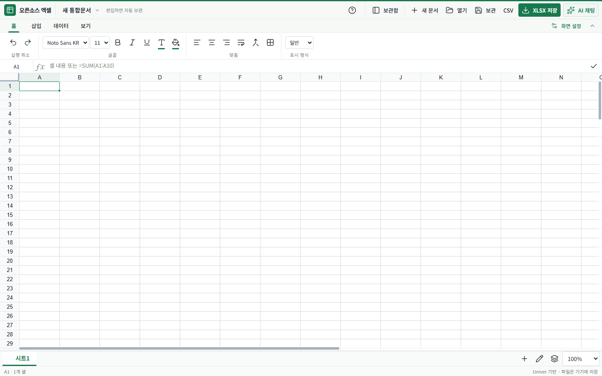

# 오픈소스 엑셀

엑셀 파일을 브라우저에서 열고, 수식과 서식을 편집한 뒤 기기에 내려받는 한국어 오픈소스 스프레드시트입니다. [오픈소스 한글](https://github.com/boclair98/rhwp-workspace)의 간편 편집·브라우저 보관·파일 다운로드 흐름을 참고한 별도 프로젝트입니다.

Microsoft Excel과 별도로 개발한 앱입니다. 한국어 AI 채팅에서 안내문과 신청서 초안을 작성할 수 있습니다.

| 배포 정보 | 상태 |
|---|---|
| 소스 버전 | `0.10.0` |
| 운영 주소 | https://excel-workspace.coders.kr |
| Coders 배포 | [운영 헬스 확인](https://excel-workspace.coders.kr/healthz) · 버전별 배포 결과는 [검증 기록](VERIFICATION.md) 참고 |
| canonical 저장소 | https://github.com/boclair98/excel-workspace |
| 조직 fork | https://github.com/coders-kr/excel-workspace — `boclair98/excel-workspace`의 실제 GitHub fork |

v0.10에서는 표 안의 한 셀을 선택한 뒤 셀 주소 없이도 후속 수정을 요청할 수 있습니다. AI가 현재 표의 열 제목, 값, 수식을 참고해 변경을 적용합니다. PC에서는 오른쪽 AI 패널을 열고 너비를 조절할 수 있습니다. 상단 **전체 화면**과 하단 **시트 배율**로 작업 영역과 셀 크기를 조절합니다.



[모바일 편집 화면](screenshots/editor-mobile.png) · [시트 관리](screenshots/sheet-manager.png) · [모바일 표 정렬](screenshots/sort-mobile.png) · [검증 상세](VERIFICATION.md)

화면은 v0.3 로컬 실행에서 예시 가계부를 열어 촬영했습니다.

## 할 수 있는 일

| 작업 | 구현 내용 |
|---|---|
| 표 편집 | 셀 값과 수식 입력, 범위 선택, 복사·붙여넣기, 실행 취소·다시 실행 |
| 리본 도구 | 홈·삽입·데이터·보기 탭, 리본 접기·펼치기, 키보드 좌우 이동 |
| 서식 | 글꼴·크기·굵게·기울임·밑줄, 글자색·채우기, 정렬·줄바꿈·병합·테두리, 일반·숫자·원화·백분율·날짜 표시 형식 |
| 시트 구성 | 행·열·시트 삽입, 행 높이·열 너비, 통합문서 복제, 시트 이름·순서·색상 변경과 복제·숨김·다시 표시·삭제, 첫 행·첫 열 고정, 하단 시트 탐색·배율 |
| 데이터 | 최대 3개 열 기준의 범위 정렬과 제목 행 설정, 범위 필터, 찾기·바꾸기, 앞뒤 공백 정리, 선택한 값·수식 지우기, 선택 범위의 숫자 개수·합계·평균 |
| 파일 열기 | XLSX, UTF-8 CSV, 이 앱이 만든 JSON 백업 |
| 파일 저장 | 여러 시트의 XLSX, 현재 시트의 값으로 만든 CSV, 현재 통합문서의 JSON 백업 |
| 내 통합문서 | 이 브라우저에 자동 보관, 이름 변경·검색, 보관본 다시 열기·삭제, 다른 탭과의 저장 충돌 감지 |
| 복구 지점 | 수동으로 시점 남기기, 문서별 최근 10개, 이름·시각 확인, 별도 복구 사본으로 열기 |
| AI 채팅 | 한국어 질문, 값·수식 변경안과 일괄 적용, 안내문·신청서 시트 작성과 후속 수정 |
| 화면 설정 | 75~200% 시트 배율, 강조색 다섯 가지, PC 리본 간격, 보관함 고정과 AI 창 폭 |

가계부 예시는 사용자가 선택했을 때 생성하는 **기능 체험용 예시 데이터**입니다. 실제 거래나 사용자의 재무 정보가 아닙니다.

## 빠르게 사용하기

1. **열기**를 누르고 지원 범위 안내를 확인한 뒤 `.xlsx`나 `.csv`를 선택합니다. 새로 시작하려면 **새 문서**를 누릅니다.
2. 셀을 더블 클릭하거나 수식 입력줄로 수정합니다. `=SUM(B2:B10)`처럼 `=`로 시작하면 수식으로 계산합니다.
3. 셀 주소 입력칸에 `A1:D10`을 입력해 범위를 선택할 수 있습니다. 정렬 창의 **첫 행은 제목** 설정은 기본으로 켜져 있으므로 제목이 없는 범위에서는 해제합니다. 필터를 만들 때는 제목 행을 포함합니다.
4. 변경 사항은 잠시 후 **내 통합문서**에 자동 보관됩니다. **보관**으로 즉시 보관할 수도 있습니다.
5. **XLSX 저장**으로 수정본을 다운로드합니다. 파일을 열었다고 원본 파일이 자동으로 덮어써지지는 않습니다.

`Tab`, `Enter`, 방향키로 셀을 이동하고, `Ctrl+C/V`로 복사·붙여넣기, `Ctrl+Z`로 실행 취소합니다. 앱의 `Ctrl+S`는 브라우저 보관이며 파일 다운로드와 구분됩니다. 하단 시트 탭 또는 모바일 시트 선택창으로 이동하고, 옆의 `+`·이름 변경·배율 버튼으로 작업합니다. PC 시트 탭은 좌우 방향키·Home·End로도 이동할 수 있습니다.

선택 범위가 10,000셀 이내이면 하단에 숫자 개수·합계·평균을 표시하며 텍스트·빈 값은 숫자 통계에서 제외합니다. 수식 입력줄에서 `=SUM(`처럼 입력하면 지원하는 주요 함수의 간단한 도움말을 볼 수 있습니다. 현재 도움말은 SUM, AVERAGE, IF, COUNT, COUNTA, SUMIF, COUNTIF, IFERROR, ROUND, VLOOKUP에 제공하며 전체 함수 자동완성이나 수식 정확성 검사를 대신하지 않습니다.

### 익숙한 리본과 내 작업 공간

상단의 **홈**에서는 글꼴·색·맞춤·표시 형식을, **삽입**에서는 행·열·시트와 셀 크기를 조절합니다. **데이터**에서 정렬·필터·찾기·선택 내용 지우기를 사용하고, **보기**에서 틀 고정·배율·보관함·화면 설정을 조절합니다. 리본은 접어 편집 공간을 넓힐 수 있습니다.

기본은 전체 폭 시트입니다. 파일 도구의 **보관함**으로 문서를 찾거나 복구 지점을 열 수 있습니다. 리본 오른쪽 **화면 설정**에서 강조색, PC 리본 간격, 보관함 고정과 AI 채팅 창 폭을 선택합니다. 화면 설정은 이 브라우저에 보관됩니다.

셀 병합은 왼쪽 위 값만 남기므로 적용 전에 안내를 확인하세요. **선택 내용 지우기**는 값·수식을 지우고 서식을 유지합니다. 첫 행·첫 열 고정과 표시 설정은 앱에서 사용할 수 있지만 XLSX 파일 변환에서의 보존 범위는 아래 표를 따릅니다.

### 시트 이름·순서·색상과 표시 상태

**삽입 → 시트 관리** 또는 하단의 **시트 관리** 버튼에서 전체 시트를 확인합니다. 이름 변경, 왼쪽·오른쪽 이동, 6가지 탭 색상과 색상 초기화, 시트 복제를 사용할 수 있습니다. 이름은 1~31자이며 같은 문서의 중복 이름과 Excel 시트 이름에 사용할 수 없는 문자를 거부합니다. 복제는 내용·서식을 새 시트에 복사하며 문서의 시트 수·셀 수·크기 한도를 검사합니다.

**시트 숨기기**와 **시트 삭제**는 대상과 영향을 확인한 뒤 적용합니다. 숨긴 시트는 내용·수식을 유지하며 이 창의 **다시 표시**로 열 수 있습니다. 마지막으로 표시된 시트는 숨기거나 삭제할 수 없습니다. 시트 삭제는 다른 시트의 수식 참조에 `#REF!` 오류를 만들 수 있으므로 중요한 변경 전에는 복구 지점을 남기세요. 시트 변경은 편집기의 실행 취소를 사용합니다.

숨기기는 접근 권한이나 암호 보호가 아닙니다. XLSX의 `hidden`·`veryHidden` 상태를 읽고 저장하지만, 이 앱의 시트 관리에서는 두 상태 모두 다시 표시할 수 있습니다. 새로 숨기는 시트에는 일반 숨김 상태를 사용합니다.

### 제목 행을 유지하는 여러 기준 정렬

표 전체 범위를 선택하고 **데이터 → 정렬**을 엽니다. **첫 행은 제목**을 기본으로 켜 두며, 범위 안의 서로 다른 열을 최대 3개까지 기준으로 선택하고 각 기준의 오름차순·내림차순을 지정합니다. 첫 번째 기준이 같은 행에 두 번째, 세 번째 기준을 순서대로 적용합니다. 제목 행은 실제 정렬 대상에서 제외하며, 제목을 포함하지 않은 범위에서는 제목 설정을 끄세요.

정렬은 창을 열 때 선택한 범위에만 적용하므로 같은 행에 속한 데이터 열을 함께 선택해야 합니다. `C2:F20`처럼 A열에서 시작하지 않는 범위도 선택 범위 안의 열을 기준으로 정렬합니다. 적용 전에 범위와 기준 요약을 확인하고, 적용한 정렬은 한 번의 실행 취소로 되돌릴 수 있습니다.

문서·시트·대상 내용·서식·구조가 바뀌었거나 범위에 병합 셀, 숨긴 행, 필터로 가려진 행 또는 배열·데이터 표 수식이 있으면 적용을 중단하고 범위를 다시 확인하도록 안내합니다. 100,000셀을 넘는 범위, 데이터 행이 두 개 미만인 범위, 전체가 비었거나 모든 기준 열이 빈 범위도 거부합니다. 모든 Excel 정렬 옵션이나 사용자 지정 목록을 제공하지는 않습니다.

### 찾기·바꾸기와 글자 정리

데이터 도구에서 **현재 시트** 또는 도구 창을 열 때 선택했던 **셀 범위**를 대상으로 찾습니다. 대소문자 구분·셀 전체 일치를 선택하고 일치 개수, 셀 주소와 내용을 확인한 뒤 이전·다음 결과로 이동할 수 있습니다. 결과는 20개씩 표시하며 정규식 대신 입력한 문자 그대로 찾습니다. 숨겨진 행·열도 지정 범위에 포함됩니다.

**바꾸기**는 숫자·논리값·수식·공유 수식·리치 텍스트를 보호하기 위해 일반 문자열 값만 수정합니다. 현재 결과 또는 모든 결과를 바꾸기 전에 변경 개수와 앞 8개의 전후 내용을 미리 보여줍니다. **공백 정리**는 텍스트의 앞뒤 공백만 제거하고 내용 중간의 공백은 유지합니다. 명시적으로 적용해야 변경되며 한 번의 실행 취소로 해당 묶음을 되돌릴 수 있습니다.

문서·시트나 대상 셀이 미리보기 이후 바뀌면 적용을 중단하고 다시 확인하도록 안내합니다. 찾을 내용은 500자, 대체 내용은 2,000자, 결과 셀은 32,767자까지 지원합니다. 이 작업은 브라우저 안에서 처리하며 외부 서버로 전송하지 않습니다.

## 보관·백업·다른 기기로 옮기기

문서는 서버 데이터베이스 대신 **현재 브라우저·현재 출처의 IndexedDB**에 저장됩니다. 같은 계정으로 접속해도 다른 기기, 브라우저, 포트 또는 도메인으로 자동 동기화하지 않습니다.

- **보관**: 현재 통합문서를 이 브라우저에 남깁니다. IndexedDB 저장 트랜잭션이 완료된 뒤에만 보관 완료를 표시합니다.
- **XLSX 저장**: 다른 스프레드시트 프로그램에서도 열 수 있는 파일을 내려받습니다. 지원하지 않는 기능은 아래 호환성 표를 확인하세요.
- **현재 문서 백업**: Univer 스냅샷을 담은 `*.excel-workspace.json`을 내려받습니다. **열기**에서 복원하면 기존 보관본을 덮어쓰지 않고 새 통합문서로 추가합니다. 복구 지점 목록·화면 설정·실행 취소 스택은 포함하지 않습니다.
- **보관본 삭제**: 브라우저 안의 해당 보관본과 그 문서에 속한 복구 지점을 함께 삭제합니다. 이미 내려받은 원본·백업 파일은 지우지 않습니다.

브라우저 데이터 삭제, 시크릿 모드 종료, 저장 공간 부족에 대비해 중요한 파일은 별도 보관하세요. 로컬 주소에서 운영 주소로 옮길 때도 XLSX 또는 JSON 백업을 내려받은 뒤 운영 주소에서 다시 열어야 합니다. 다중 탭의 같은 문서 공동 편집·자동 병합은 지원하지 않습니다.

### 수정 전 상태를 남기는 복구 지점

**내 통합문서 → 복구 지점**에서 이름을 입력하고 **지점 남기기**를 누릅니다. 현재 변경 사항을 먼저 정상 보관한 뒤 해당 스냅샷을 저장합니다. 지점 이름은 1~80자이며 문서별 최근 **10개**를 유지합니다. 11번째 지점을 남기면 가장 오래된 지점을 같은 저장 트랜잭션에서 정리하며, 화면에서 정리할 지점과 시각을 안내합니다.

지점의 **사본으로 복원**을 누르고 확인하면 새 문서 식별자와 ‘복구 사본’ 이름으로 엽니다. 현재 문서는 덮어쓰지 않고, 현재 변경 사항을 보관하지 못하면 복원을 중단합니다. 복구 지점 삭제도 별도 확인하며 다른 지점과 현재 문서는 유지합니다. 지점은 이 브라우저에만 남고 JSON 파일 백업·다른 기기에 자동 포함되지 않습니다.

### 여러 탭에서 저장이 충돌했을 때

저장 시 예상했던 보관 시각과 실제 보관 시각이 다르면 오래된 탭의 덮어쓰기를 중단합니다. **내 변경 사본 보관**을 누르면 현재 탭의 내용을 새 통합문서로 남깁니다. **최신 보관본 열기**는 현재 탭의 미보관 변경을 버린다는 확인 후 최신 보관본을 엽니다. 다른 탭에서 원래 보관본을 삭제한 경우에도 새 사본 보관으로 내용을 남길 수 있습니다.

이 동작은 저장 충돌 감지이며 실시간 공동 편집이나 셀 단위 병합이 아닙니다. 기존 버전의 탭은 새 충돌 규약을 사용하지 않으므로 업데이트할 때 이전 버전 탭을 닫고 다시 여세요.

## 파일 지원 범위와 한계

현재 입출력은 ExcelJS와 Univer 스냅샷 사이의 변환 어댑터로 구현합니다. Univer의 유료 파일 교환 서버나 Microsoft API를 사용하지 않습니다.

| 항목 | 지원 범위 |
|---|---|
| XLSX 값·수식 | 문자열, 숫자, 불리언, 수식, 여러 시트 |
| 기본 서식 | 글꼴 이름·크기·굵게·기울임·밑줄·취소선, RGB 글자/배경색, 정렬·줄바꿈, 숫자 표시 형식, 위·아래·왼쪽·오른쪽 테두리 |
| 시트 구조 | 병합, 열 너비, 행 높이, 행·열 숨김 상태, 시트 표시·숨김·매우 숨김(`veryHidden`) 상태, RGB 탭 색상 |
| 날짜 | ExcelJS에서 읽은 날짜를 1900 날짜 체계로 정규화. 1904 날짜 체계의 날짜·시간 왕복 테스트 포함 |
| CSV | UTF-8, 쉼표·따옴표·여러 줄 문자열. 내보낼 때 현재 시트의 값만 포함하며 UTF-8 BOM을 붙입니다. |
| JSON 백업 | 이 앱의 `excel-workspace` 형식 버전 `1`. 현재 통합문서만 포함합니다. |

다음 항목은 파일 변환 시 완전한 보존을 보장하지 않습니다: 차트, 피벗, 그림·도형, VBA·매크로, 외부 통합문서 링크, 테마 색(테마 기반 탭 색상 포함), 대각선 테두리·고급 서식, 조건부 서식, 주석, 하이퍼링크, 데이터 유효성 검사, 이름 정의, 틀 고정, 필터 설정, 인쇄 설정. 리치 텍스트는 일반 문자열로 변환될 수 있습니다. **원본 파일을 별도로 보관하고 저장본을 다시 확인하세요.**

구형 `.xls`, `.xlsm`, 암호화·암호 보호 파일은 지원하지 않습니다. Microsoft Excel과 모든 함수·계산 결과·날짜·서식이 동일하다고 보장하지 않습니다. 수식은 엑셀에서 다시 열 때 재계산하도록 저장합니다. CSV는 서식과 수식을 보존하는 백업 형식이 아니며, CSV 내보내기는 수식 주입 위험이 있는 문자열을 이스케이프합니다.

현재 파일 한도는 **10MB**, **30시트**, **통합문서 전체 100,000셀**, **시트당 10,000행·200열**입니다. XLSX는 압축 파일 내부의 선언된 확장 크기 **64MB**와 항목 수 **2,000개**도 검사합니다. 변환 후 JSON 통합문서도 10MB 이내여야 하며, 셀 문자열은 32,767자·수식은 8,192자까지 지원합니다. 잘못된 주소·음수 크기·중복 시트·겹치는 병합·과도하게 깊은 백업과 표시된 시트가 하나도 없는 통합문서는 거부합니다.

보관함은 최대 **50개 통합문서**를 지원하며 브라우저의 저장소 할당량이 먼저 제한될 수 있습니다. 50개에 도달해도 기존 문서 갱신은 가능하며 한도를 넘는 새 문서는 기존 데이터를 바꾸지 않고 거부합니다. 실제 작업 성능은 기기, 파일 구조와 수식 수에 따라 달라집니다. 파일 검증은 모든 악성 파일이나 호환성 문제를 탐지하는 보안 보증이 아닙니다.

## AI 채팅

1. 상단 **AI 채팅**을 열고 ‘A1:C3에 신청자 명단을 만들어줘’처럼 적습니다. 여러 셀을 선택하거나 주소를 적으면 해당 범위를 사용합니다. 한 셀을 선택하면 붙어 있는 표와 주변 빈 공간을 작업 범위로 잡습니다. 빈 시트에서 새로 시작할 때는 최대 10열·20행을 사용합니다. 보내기 위에 표시된 범위를 확인하세요.
2. 요청한 셀 변경은 응답 검증 후 바로 적용되고 채팅에 변경 내역이 표시됩니다. 리본의 **실행 취소**로 변경 묶음을 되돌릴 수 있습니다. **XLSX 저장**으로 적용한 파일을 내려받습니다.
3. **안내문**이나 **신청서**는 필수 항목만 입력한 뒤 **초안 받기**를 누르면 선택한 첫 셀에도 작성됩니다. 답변에서 **복사**하거나 ‘한 문장으로 줄여 주세요’, ‘이 초안을 B2에 넣어줘’처럼 이어서 요청합니다.

최대 200셀 안에서 일반 값과 새 수식 추가를 지원합니다. 기존 수식·병합·리치 텍스트 셀은 보호합니다. 적용하기 전에 시트와 셀 내용을 다시 확인합니다. 문서 초안은 기관의 공식 양식과 내용을 확인해 사용할 수 있습니다. 대화는 현재 페이지에 보관되며 **새 대화**를 누르거나 페이지를 새로고침하면 비워집니다.

운영자가 OpenAI 키를 등록한 공유 모드에서는 Coders에 로그인한 방문자가 운영자 연결을 사용합니다. 요청은 계정당 분당 6회와 서버 인스턴스당 기본 분당 30회로 제한되며 사용량은 운영자의 OpenAI 프로젝트에 집계됩니다. 공유 키 설정이 비어 있으면 설정된 Coders 관리형 Claude 연결을 사용합니다. [Coders 관리형 AI 문서](https://coders.kr/managed-ai.txt)

채팅에서 보낸 글과 최근 대화가 화면에 표시된 제공자에 전달됩니다. **셀 연결**이 켜져 있으면 화면에 표시된 작업 범위의 값·수식과 시트 이름을 함께 보냅니다. 일반 대화만 하려면 **셀 연결**을 끕니다. 양식에서 초안을 요청할 때는 글만 보냅니다. 앱은 AI 본문과 응답을 로그에 남기지 않습니다. [데이터 처리 안내](SECURITY.md)

로컬에서 AI 환경 변수가 없으면 연결 상태를 안내합니다. `/api/status`에서 설정과 로그인 상태를 확인할 수 있습니다. 연결·한도 오류가 생기면 작성 중인 내용을 그대로 두고 다시 보낼 수 있습니다.

## 기술과 구조

| 영역 | 사용 기술 |
|---|---|
| 앱 셸 | TypeScript, Vite, HTML/CSS |
| 편집·계산 엔진 | Univer Sheets 공개 코어·필터·정렬 프리셋 |
| XLSX / CSV | ExcelJS / Papa Parse |
| 로컬 저장 | IndexedDB, `idb` |
| 아이콘 / 글꼴 | Lucide, Noto Sans KR Variable |
| 서버 | Node.js HTTP 정적 서버와 제한된 AI 프록시 |
| 검증 | TypeScript, Node test runner/tsx, fake-indexeddb, Playwright |

```text
src/main.ts          앱 셸, 파일과 보관 흐름
src/ai-panel.ts      AI 채팅, 셀 변경안과 문서 초안
src/ai-edit.ts       작업 범위 확인과 셀 변경 일괄 적용
src/ribbon.ts        홈·삽입·데이터·보기 도구와 화면 설정
src/sheet-manager.ts 시트 이름·복제·순서·색상·표시·삭제 UI
src/sheet-guards.ts  시트 이름·복제 한도·마지막 표시 시트 보호
src/sort-tools.ts    정렬 기준·제목 행 설정 UI
src/sort-configuration.ts  정렬 범위·상대 열 설정과 보호 규칙
src/history.ts       복구 지점 목록·생성·삭제·사본 복원 UI
src/data-tools.ts    찾기·바꾸기·공백 정리와 미리보기 UI
src/data-operations.ts  검색·문자 변경 대상 계산과 보호 규칙
src/editor.ts        Univer 초기화와 편집 어댑터
src/model.ts         통합문서 생성·구조·한도 검증
src/files.ts         XLSX/CSV 입출력과 다운로드
src/storage.ts       IndexedDB 보관함
src/style.css        한국어 UI와 반응형 스타일
ai.mjs               AI 입력·출력 검증과 제공자 호출
ai-formula.mjs       서버와 편집기가 공유하는 AI 수식 검증
server.mjs           정적 파일, 상태·건강 확인, AI HTTP API
tests/               파일 왕복, 보관, 서버 경계 테스트
public/licenses/     배포에 포함되는 원문 라이선스 고지
Dockerfile           빌드 단계와 비루트 런타임
coders.yaml          Coders 서비스·관리형 AI 선언
design.md            화면 설계와 검증 계획
```

참고한 한글 프로젝트의 소스나 RHWP 엔진은 복사하지 않았습니다. 파일을 열고 편집하고 보관하는 제품 흐름을 참고했으며, 스프레드시트 엔진과 입출력 어댑터는 별도로 구성했습니다. 이 프로젝트의 MIT 라이선스는 의존 라이브러리의 라이선스를 바꾸지 않습니다.

## 로컬 실행

Node.js **22.12 이상**과 npm이 필요합니다. 저장소 루트에서 실행합니다.

```sh
npm ci
npm run build
npm start
```

주소는 `http://127.0.0.1:7730`, 건강 확인은 `http://127.0.0.1:7730/healthz`입니다. 빌드된 파일을 제공하므로 코드를 수정한 뒤에는 다시 빌드하세요.

개발 중에는 터미널을 두 개 엽니다. 첫 번째에서 Vite를 실행합니다.

```sh
npm run dev
```

두 번째에서 API 서버를 7731 포트로 실행합니다. Windows PowerShell:

```powershell
$env:PORT = '7731'
npm start
```

macOS/Linux 셸:

```sh
PORT=7731 npm start
```

브라우저는 7730으로 접속하며 Vite가 `/api/*`와 `/healthz`를 7731로 전달합니다. 별도 AI 연결 없이도 개발할 수 있습니다. 로컬 서버는 기본적으로 루프백 주소에만 바인딩합니다.

```sh
npm run typecheck
npm test
npm run build
```

## 환경 변수와 데이터

| 이름 | 목적 | 필수 여부 | 설정 위치·발급 경로 |
|---|---|---|---|
| `PORT` | HTTP 서버 포트, 기본 7730 | 아니요 | 로컬 셸. 컨테이너 기본값은 8080 |
| `HOST` | 서버 바인딩, 기본 127.0.0.1 | 아니요 | Dockerfile에서 0.0.0.0 |
| `CODERS_NATIVE` | Coders 게이트에서 전달한 방문자 신원을 사용하는 모드 | Coders 배포 시 | `coders.yaml`의 서버 환경 설정 |
| `ANTHROPIC_BASE_URL` | 관리형 Claude 프록시 주소 | AI 사용 시 | Coders의 `type: llm` 리소스가 공급 |
| `ANTHROPIC_API_KEY` | 프로젝트 전용 관리형 토큰. 실제 개인 제공자 키가 아님 | AI 사용 시 | Coders가 서버에 주입. 클라이언트에 노출 금지 |
| `AI_MODEL` | 허용 모델 목록 내 사용할 모델 | 아니요 | `coders.yaml`과 서버 기본 설정 |
| `OPENAI_API_KEY` | 개인 OpenAI 프로젝트 키 | 개인 OpenAI 사용 시 | [OpenAI API 키 관리](https://platform.openai.com/api-keys)에서 발급. 로컬 `.env.local` 또는 Coders 서버 비밀 변수 |
| `OPENAI_MODEL` | OpenAI Responses 모델, 기본 `gpt-5.4-mini` | 아니요 | 서버 환경 변수 |
| `OPENAI_SHARED` | Coders 로그인 방문자에게 운영자 OpenAI 연결 제공 | 공유 모드 사용 시 | `coders.yaml`에서 `true` |
| `PUBLIC_ORIGIN` | AI 요청을 허용할 브라우저의 공개 주소 | 프록시가 내부 주소로 전달할 때 | `coders.yaml`의 운영 주소 |
| `OPENAI_SHARED_RPM` | 공유 OpenAI의 서버 인스턴스당 분당 요청 상한 | 아니요 | 서버 환경 변수, 기본 30 |
| `OPENAI_CODERS_USER_REF` | 한 계정에 연결할 때 사용하는 앱별 코드 | 공유 모드를 끄고 한 계정으로 연결할 때 | 운영 앱 로그인 → AI 채팅 → 개인 OpenAI 연결 코드 |

로컬은 Git에서 제외된 `.env.local`의 `OPENAI_API_KEY`를 `npm start`로 읽습니다. 개인 키의 로컬 사용은 루프백으로 바인딩한 서버에서 지원합니다.

공유 모드를 처음 배포하려면 Coders 프로젝트의 서버 비밀 환경 변수에 `OPENAI_API_KEY`를 등록한 뒤 배포합니다. Coders에 로그인한 뒤 **AI 채팅**에서 가상의 안내문 초안으로 연결을 확인할 수 있습니다. [Coders 환경 변수 설정](https://coders.kr/llms.txt)

배포 API용 Coders 에이전트 토큰은 애플리케이션의 환경 변수와 구분합니다. 플랫폼의 승인 절차로 발급받아 Git에서 제외된 `.coders/` 등 승인된 로컬 비밀 저장소에서만 사용합니다. 실제 토큰을 명령 기록·문서·커밋에 넣지 마세요.

서버 관계형 데이터베이스, 외부 공공데이터 API, Microsoft 계정 연동은 없습니다. 별도 DB 설치나 서버 마이그레이션도 필요하지 않습니다. v0.2는 기존 이름인 `excel-workspace-v1` 데이터베이스를 **스키마 버전 2**로 올려 기존 `books`를 유지하면서 `checkpoints` 저장소와 문서별 인덱스를 추가합니다. 이전 버전 탭이 업그레이드를 막으면 탭을 닫으라는 오류를 표시하며 기존 문서는 지우지 않습니다.

`updatedAt`·`createdAt`은 Unix 밀리초 시각을 저장하고 화면에서 사용자의 지역 설정에 맞게 표시합니다. 동일 밀리초에 저장해도 충돌 검사용 저장 시각이 단조 증가하도록 처리합니다. JSON 백업 형식 버전은 계속 `1`이며 IndexedDB 스키마 버전과 다른 개념입니다.

## Coders.kr 배포

배포할 때마다 [최신 에이전트 안내](https://coders.kr/llms.txt), [관리형 AI 안내](https://coders.kr/managed-ai.txt), [플랫폼 계약](https://github.com/coders-kr/template-coders/blob/main/PLATFORM.md)을 확인하세요. 여기의 절차가 최신 문서와 다르면 플랫폼의 현재 계약을 확인해 배포 설정을 갱신합니다.

`coders.yaml`은 `native` 모드의 공개 `web` 서비스와 관리형 `ai` 리소스를 선언합니다. `Dockerfile`은 `npm ci`와 빌드를 이미지 생성 시 실행한 뒤 Node 비루트 사용자로 서비스합니다. 런타임에 npm 설치·빌드를 수행하지 않습니다. 정적 자산은 캐시하고 HTML·API 상태는 새로 확인합니다.

앱은 플랫폼이 주입한 `PORT`로 수신하며 공개 서비스 포트는 8080입니다. `/healthz`는 앱 프로세스의 건강 상태와 버전을, `/api/status`는 제공자 설정과 로그인 상태를 반환합니다. 관리형 요청은 게이트가 검증한 `X-Coders-User`만 AI 프록시로 전달합니다. OpenAI 요청은 이 헤더를 전달하지 않습니다. Coders native 게이트 뒤에서만 이 신원 확인을 사용합니다.

저장소 연결 관계:

```text
로컬 origin ──> boclair98/excel-workspace (canonical, 배포 소스)
                     │
                     └──> coders-kr/excel-workspace (실제 GitHub fork)
```

1. `git status`, 추적/신규 파일, staged diff를 확인합니다. `.env*`, `.coders/`, 업로드 문서, 개인 데이터, 비밀값을 공개하지 않습니다.
2. 타입 검사·테스트·빌드와 실제 파일 편집 흐름, 모바일·PC 화면을 확인합니다.
3. canonical 저장소의 실제 기본 브랜치에 커밋·푸시합니다. 현재 기본 브랜치는 `main`입니다.
4. 조직 저장소가 없으면 GitHub의 fork 작업으로 생성합니다. 이름만 같은 독립 저장소를 덮어쓰거나 강제 푸시하지 않습니다.
5. fork의 부모가 정확히 `boclair98/excel-workspace`인지 확인하고 동기화합니다.

```sh
gh repo sync coders-kr/excel-workspace -b main
gh api repos/coders-kr/excel-workspace --jq '{fork: .fork, parent: .parent.full_name, default_branch: .default_branch}'
gh api repos/boclair98/excel-workspace/commits/main --jq .sha
gh api repos/coders-kr/excel-workspace/commits/main --jq .sha
```

6. 양쪽 기본 브랜치의 **전체 커밋 SHA가 일치**하는지 확인합니다. 다르면 배포 완료로 보고하지 않습니다.
7. 승인된 로컬 에이전트 인증으로 `POST https://coders.kr/v1/agent/deploys`를 호출합니다. 현재 요청 메타데이터는 아래와 같습니다. 토큰은 이 JSON에 넣지 않습니다.

```json
{
  "repo": "https://github.com/boclair98/excel-workspace",
  "name": "excel-workspace"
}
```

8. 모든 Coders 요청에 명시적 `User-Agent`를 사용하고 인증 토큰은 필요한 Coders API 요청에만 전달합니다. 기존 프로젝트 이름이 있으면 같은 프로젝트를 갱신합니다.
9. `GET /v1/agent/projects/excel-workspace`를 약 10~15초 간격으로 확인합니다. 배포 ID와 `last_deployment.status`를 기록하고 `ready`, `build_failed`, `release_failed` 등 terminal status까지 확인합니다. 실패 시 오류와 필요 로그를 점검하고 원인을 고친 뒤 재배포합니다.
10. 운영 루트·`/healthz`·`/api/status`, 실제 편집→보관→XLSX 다운로드→재열기, AI 로그인과 초안·후속 수정 흐름, 모바일·PC 화면을 확인합니다.

## 검증 체크리스트

자동화 테스트는 파일 왕복·보관의 원자성·데이터 도구·복구 및 저장 충돌·AI 입력과 HTTP 경계를 다룹니다. 모의 AI 제공자 응답 테스트는 실제 제공자 호출 성공을 증명하지 않습니다. 리본의 실제 조작·반응형 화면 검증은 이 자동화 테스트와 구분합니다.

| 버전 | 타입 검사·빌드 | 단위 테스트 | Chrome 브라우저 | 화면 검토 |
|---|---|---|---|---|
| v0.1 | 통과 | 18개 통과 | 4개 통과 | 360×800, 390×844, 768×1024, 1440×900 |
| v0.2 | 통과 | 31개 통과 | 10개 통과 | 편집기·복구·찾기 |
| v0.3 | 통과 | 42개 통과 | 15개 통과 | 같은 4개 크기에서 편집기·시트 관리·정렬 |
| v0.3.1 | 통과 | 42개 통과 | 시트 탐색·후원 버튼 회귀 2개 통과 | 같은 4개 크기에서 후원 버튼과 시트 도구 분리 |
| v0.4 | 통과 | 47개 통과 | 18개 통과 | 같은 4개 크기에서 AI 요청과 셀 변경안 검토 |
| v0.5 | 통과 | 48개 통과 | 18개 통과 | 같은 4개 크기에서 전체 폭 시트, 화면 설정, AI 창 확인 |
| v0.6 | 통과 | 51개 통과 | 관련 7개 통과 | 같은 4개 크기에서 채팅, 문서 양식, 셀 변경안과 적용 확인 |

v0.3 검증에는 시트 관리와 실행 취소, 정렬 후 수식·행 연결 유지, XLSX 탭 색상·숨김 왕복, 기존 편집·파일·복구 흐름을 포함합니다. 화면은 키보드 포커스, 가로 넘침, 모바일 조작 크기와 콘솔 오류를 확인했습니다. [검증 상세](VERIFICATION.md)

- [x] Coders 빌드·기동, 배포 상태 `ready`, 공개 `/healthz`의 `ok` 응답
- [x] 운영 편집·보관·다운로드 및 XLSX·CSV·JSON 재열기
- [ ] Coders 로그인 후 실제 관리형 AI 응답 확인
- [ ] Coders 로그인 상태의 운영 공유 OpenAI 호출 확인


## 기여와 라이선스

앱의 직접 작성한 코드는 [MIT](LICENSE)로 공개합니다. 구성 요소의 원문 고지는 [THIRD_PARTY_NOTICES.md](THIRD_PARTY_NOTICES.md)와 [public/licenses](public/licenses/)에 있습니다. Noto Sans KR 글꼴은 SIL OFL 1.1, Univer는 Apache 2.0 등 각자 라이선스를 유지합니다.

수정 제안은 [기여 안내](CONTRIBUTING.md), 민감한 보안 문제는 [보안 안내](SECURITY.md)를 참고하세요. 사용자 문서, 개인정보, API 키와 토큰을 이슈·PR·테스트 데이터에 포함하지 마세요.
